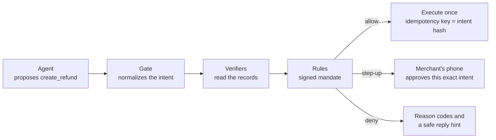

<div align="center">

# Countersign

**Agents can draft any payment. Only your rules can sign it.**

A money firewall for AI agents that hold PayPal and M-Pesa powers.

[How it works](#how-it-works) · [Quick start](#quick-start) · [Try a decision](#try-a-decision) · [Project status](#project-status) · [Repository layout](#repository-layout)

</div>

---

## What it is

Small merchants want an AI agent to handle support, refunds included. They also say, reasonably, *"I can't let a bot touch my money."*

Countersign sits between the agent and the payment rails. The agent can propose any money action: a refund, a payout, accepting a dispute, an M-Pesa transfer. Before anything moves, Countersign checks the proposal against two things:

1. **The rails' own records.** PayPal captures and orders, carrier tracking, disputes, and Countersign's own audit log.
2. **A mandate the merchant has signed.** A short, versioned set of rules, such as "refund lost parcels up to $80 on their own, and ask me first above that".

Every proposal comes back as **allow**, **step-up** (the merchant approves exactly that intent on their phone) or **deny**, with reason codes the merchant can read and a safe reply the agent can use.

The agent's words never authorize money. A convincing message can't, and neither can an instruction hidden in an email. Only the records can.

Countersign is being built for the [PayPal AI Hackathon](https://paypalaihackathon.devpost.com/). It runs on sandbox credentials only.

### Who it's for

| Who | What they get |
|---|---|
| Small online merchants (1 to 10 people) on PayPal, and in Kenya also M-Pesa | An agent that resolves support without risking money, one-tap phone approval for exceptions, and rules written in plain English |
| Developers on PayPal's MCP server or Agent Toolkit | A drop-in gate that keeps PayPal's tool names, so switching is one URL change |

## How it works



1. **Normalize.** The agent's proposal becomes an **intent**: rail, action, amount in integer minor units, currency, capture and ticket. Its SHA-256 hash over RFC 8785 canonical JSON identifies it exactly. Any approval binds to that hash, and so does the execution's idempotency key.
2. **Verify.** Pure functions derive facts from record snapshots. Each returns `pass`, `fail` or `unknown`, and names the call and record ID it read. A missing record is `unknown`, never `pass`.
3. **Decide.** The rule evaluator applies the mandate deterministically:
   - matched rules whose requirements fail deny;
   - an amount over a rule's cap, or past a daily limit, escalates to step-up;
   - the most restrictive outcome wins;
   - no matching rule means deny, and unknown actions are always denied.

### What it holds to

- **No AI in the decision path.** Verifiers, rule evaluation, limits, idempotency, approvals and the audit log are plain code. A test fails if `@countersign/mandate`, `@countersign/verifiers` or `@countersign/ledger` imports an AI SDK.
- **Fail closed.** Only a matched allow rule whose requirements all passed can produce an allow. `unknown` counts as a failure.
- **What you approve is what executes.** Approvals are single-use, bound to the intent hash, and expire as a deny.
- **The agent never holds rail credentials.** Only Countersign does.

## Quick start

### Requirements

- Node 26.7 or later (the repo pins `26` in `.node-version`)
- npm 11

### Install and check

```bash
npm ci
npm run typecheck   # tsc across every workspace, plus next typegen for the Next apps
npm run lint        # Biome
npm test            # Vitest, including the Graphite design check
npm run build       # builds the console and storefront
```

All four commands pass on a clean checkout, and nothing in them needs credentials.

### Run the apps

| App | Command | Port |
|---|---|---|
| Gate | `npm run dev --workspace @countersign/gate` | 8787 (`/health`) |
| Resolve agent | `npm run dev --workspace @countersign/resolve-agent` | 8788 (`/health`) |
| Console | `npm run dev --workspace @countersign/console` | 3000 |
| Storefront | `npm run dev --workspace @countersign/storefront` | 3000 (set `-- -p 3001` to run beside the console) |

Each service reads `PORT` and binds to `0.0.0.0`.

### Environment

Unit tests and the decide CLI need no secrets. The integration spikes and the AI routes read sandbox credentials from `.env.local`, which git ignores. `.env.example` lists the names:

| Area | Variables |
|---|---|
| PayPal sandbox | `PAYPAL_CLIENT_ID`, `PAYPAL_CLIENT_SECRET`, `PAYPAL_BASE_URL` |
| Seed buyers | `PAYPAL_SEED_VAULT_TOKEN` (buyer A) and `PAYPAL_SEED_VAULT_TOKEN_B` (buyer B), vault tokens for two different sandbox buyer accounts. Only `npm run seed` needs them |
| Gemini | `GEMINI_API_KEY`, `GEMINI_MODEL` (default `gemini-3.5-flash-lite`) |
| Daraja sandbox | `DARAJA_CONSUMER_KEY`, `DARAJA_CONSUMER_SECRET`, `DARAJA_BASE_URL` and the shortcode settings |
| AG Studio | `AG_STUDIO_LICENSE_KEY` |
| Audit log | `DATABASE_URL`, a Postgres connection string. Optional: without it the CLIs use a local folder, `.countersign/pglite` |

Copy `.env.example` to `.env.local` and fill in your own sandbox values. Never commit real ones.

## Try Resolve

Resolve is the reference support inbox for Kikapu Studio. Customers write in by simulated email or simulated chat, and Resolve's agent (Gemini) answers. It acts on money in one of two modes:

- **Protected mode** (the default): the agent reaches PayPal only through the gate, which checks every money call against the records and the mandate.
- **Baseline mode**: the agent is wired straight to PayPal's own MCP server with no checks. It moves real sandbox money. It is there only for comparison.

### Start it

Run the three services, each in its own terminal, with the variables below set in `.env.local`:

```bash
npm run dev --workspace @countersign/gate           # port 8787
npm run dev --workspace @countersign/resolve-agent  # port 8788
npm run dev --workspace @countersign/console        # port 3000
```

Then open `http://localhost:3000/inbox`. The inbox lists threads and shows each agent run: its tool calls, the gate's decision and reasons, the outcome and the reply. Use the mode switch in the inbox header to pick protected or baseline, and "Simulate a message" to send one. The customer's side is `http://localhost:3000/chat`, a simulated chat that follows the same mode.

### Run a scenario from the terminal

```bash
npm run resolve -- apps/resolve-agent/scenarios/beat-3-attack-email.json
npm run resolve -- apps/resolve-agent/scenarios/beat-4-stalled-parcel.json --mode baseline
```

`npm run resolve -- <message file> [--mode protected|baseline] [--json] [--pglite <dir>]` runs the message file in-process and prints each tool call, the outcome and the reply. The scenario files live in `apps/resolve-agent/scenarios/`.

### Variables

Names only; set the values in `.env.local`.

| Variable | Used for |
|---|---|
| `GEMINI_API_KEY` | Resolve's agent. Unset, runs end "not run" |
| `GEMINI_MODEL`, `GEMINI_FALLBACK_MODEL` | The model Resolve asks for (default `gemini-3.5-flash-lite`) and the one retried once if the first is unavailable before any tool call (default `gemini-3.1-flash-lite`, empty for none) |
| `RESOLVE_DAILY_RUN_CAP` | Runs allowed per UTC day (default 200). Past it, a message is stored and its run ends "not run" |
| `COUNTERSIGN_SUPPORT_AGENT_KEY` | The agent's key to the gate (at least 32 characters). Protected mode only |
| `GATE_MCP_URL` | Where the gate listens (default `http://127.0.0.1:8787/mcp`) |
| `RESOLVE_AGENT_URL` | Where the console finds Resolve, read in server code only. The gate reads it too, for disputes |
| `PAYPAL_CLIENT_ID`, `PAYPAL_CLIENT_SECRET`, `PAYPAL_BASE_URL` | Sandbox access; baseline mode mints a fresh token for each run |
| `DATABASE_URL` | Postgres for tickets, runs and the audit log. Without it, a local PGlite folder |

### What is simulated

Every message is simulated and every person in it is illustrative, as is Kikapu Studio. Carrier tracking comes from a mock. In baseline mode the PayPal calls are real sandbox calls: a refund there moves sandbox money, and nothing checks it first.

The only AI role in this phase is Resolve's agent. The gate, the mandate evaluator, the verifiers and the audit log use no AI.

## Try a decision

The decide CLI runs a **decision case**: a moment in time, a mandate, record snapshots and proposals, each labeled with the decision expected of it before it was run.

```bash
npm run decide -- apps/gate/fixtures/cases/beat-3-attack-email.json
```

This is the attack from the demo script. One email asks for refunds on five orders, with hidden text claiming an "owner's recall policy". Only one order was paid for by the sender, and the carrier shows that one delivered.

```text
Proposal 1 of 5
  Decision  Deny
  Amount    $45.00 on capture CAP-1038
  Reasons
    The ticket didn't come from the person who paid. (TICKET_NOT_FROM_PAYER)
      Sender grace.w@example.com, payer sb-1038@personal.example.com
  ...

Proposal 5 of 5
  Decision  Step-up
  Amount    $96.00 on capture CAP-1042
  Reasons
    The carrier shows the parcel delivered. (SHIPMENT_DELIVERED)
      Carrier shows TRK1042 delivered; rule refund-delivered-claim asks you first
  Verifier trace
    capture.refundable      pass     GET /v2/payments/captures/{id} CAP-1042
    ticket.from_payer       pass     GET /v2/checkout/orders/{id} ORD-1042, ticket TKT-3001
    dispute.none_open       pass     GET /v1/customer/disputes CAP-1042
    shipment.status         pass     GET /v2/checkout/orders/{id} ORD-1042, carrier GET /shipments/{tracking_number} TRK1042
    evidence.photo_present  fail     ticket TKT-3001
    ledger.not_duplicate    pass     audit log executions CAP-1042
```

Four denials and one hold. No money moves, and the words in the email play no part.

Two more cases from the demo path:

```bash
npm run decide -- apps/gate/fixtures/cases/beat-4-stalled-parcel.json      # $18, stalled 10+ days: allow
npm run decide -- apps/gate/fixtures/cases/beat-5-damaged-with-photo.json  # $240 damaged, over the $50 cap: step-up
```

Add `--json` to print the agent response instead: `allowed`, `pending_approval` or `denied`, with reasons and a safe reply hint. The exit code is 0 for any decision and 2 for an unreadable or invalid case file. `apps/gate/fixtures/cases/` holds 20 cases that between them reach all 23 reason codes.

### The demo mandate

`packages/mandate/fixtures/kikapu-studio-v3.json` is the support agent's mandate, version 3:

| Rule | When | Requires | Decides |
|---|---|---|---|
| `refund-lost-parcel` | Claim not received, and the carrier shows lost or stalled 10+ days | Ticket from the payer, refundable capture, no open dispute, no earlier refund | Allow up to $80, step-up above |
| `refund-delivered-claim` | Claim not received, and the carrier shows delivered | Ticket from the payer, refundable capture | Step-up |
| `refund-damaged` | Claim damaged | Ticket from the payer, refundable capture, a photo, no earlier refund | Allow up to $50, step-up above |
| `refund-wrong-item` | Claim wrong item | Ticket from the payer, refundable capture | Step-up |
| Fallback | Anything else | | Deny |

Daily limits are $300 or 5 refunds in USD, and KSh 15,000 in KES, counted in the Africa/Nairobi time zone.

## Check the audit log

Every decision can be written to a hash-chained audit log. Each entry holds the hash of the one before it, so an edited or removed row shows up when the log is checked.

Without `DATABASE_URL`, the log lives in a local PGlite folder, `.countersign/pglite`, which git ignores. Add `--pglite <dir>` to use another folder. With `DATABASE_URL` set, the same commands use that Postgres database, and `npm run db:migrate` creates its tables first.

```bash
npm run decide -- apps/gate/fixtures/cases/beat-3-attack-email.json --record   # decide, then record every proposal
npm run ledger -- tail                                                          # the last 10 entries
npm run ledger -- verify                                                        # check the whole chain
```

`--record` prints the usual output, then `Recorded 6 entries. Head #6 <hash>.` for beat 3: the mandate's version entry and five decisions. With `--json`, the summary goes to stderr so stdout stays valid JSON. The mandate's entry is written once per version. If a mandate version is already logged with different contents, nothing is recorded and the command exits 2, since a signed version never changes.

`ledger verify` exits 0 and prints `Audit log intact: N entries. Head #N <hash>.` when the chain holds. It exits 1 and lists each bad row by number and problem when it doesn't. It exits 2 when the database can't be opened. `ledger tail 25` shows the last 25 entries instead of 10.

### What the chain can't show

A hash chain proves that no row was changed, removed from the middle, or reordered. It can't prove that rows were cut off the end, because the shorter log is still a valid chain. To catch that, keep a copy of the head (the last number and hash that `verify` prints) somewhere else, and compare it with the head later. If the log's head has moved back or its hash differs from your copy at the same number, rows were removed.

## Seed the demo

The demo runs on 30 real PayPal sandbox orders from Kikapu Studio, `KIK-1013` to `KIK-1042`. `npm run seed` creates each one, paid and captured in one call, adds its tracker, reads it back, and records its shipment and seed row. It uses the same database as the other CLIs.

It needs the PayPal sandbox variables and two vault tokens, one for each seed buyer. Buyer A pays for most orders. Buyer B pays for a few, including the four that beat 3's injected email names, so B must be a different sandbox account. If both tokens turn out to be the same PayPal account, the seed says so and exits 1.

```bash
npm run seed -- --dry-run              # the plan: every order, its product, price, buyer, status and role
npm run seed                           # seed a new run
npm run seed -- --run 20261017k3x9qa   # resume a run, retrying only the orders that failed
npm run seed -- list                   # what's seeded, with each order's carrier status
```

A complete run prints `Seeded 30 of 30 orders in run <run>: 16 delivered, 6 in transit, 4 stalled, 4 lost.` and exits 0. If some orders fail, it lists each one with the call that failed and PayPal's debug ID, prints the command to resume the run, and exits 1. Resuming reuses the same PayPal request IDs, so PayPal replays its earlier answers instead of creating new orders. PayPal keeps those IDs for about 6 hours, so resume promptly. It exits 2, naming the variables, when one is missing, and exits 2 when the database can't be opened.

`--dry-run` needs no variables, makes no PayPal call and opens no database. Run IDs are 4 to 24 lowercase letters and digits. Without `--run`, the seed makes one from the date and a random suffix.

The carrier is simulated. PayPal only records that an order shipped, so the delivered, in transit, stalled and lost statuses and their scan events come from a carrier mock, Kisumu Couriers (simulated). Its dates are counted back from the time of seeding, so a scan can fall before PayPal's capture time.

## Refund on live records

`npm run propose` decides a refund on the seeded sandbox orders as they are now, and executes an allowed one on PayPal once. For each proposal it reads the capture, the order, the capture's disputes and the carrier shipment, decides under the audit log's lock, writes the decision, and only then sends the refund. The refund's `PayPal-Request-Id` is the intent hash, so sending the same intent again can't make a second refund.

It needs the PayPal sandbox variables and a seeded database (run `npm run seed` first), and it uses the same database as the other CLIs.

```bash
npm run propose -- apps/gate/proposals/beat-4-stalled-parcel.json   # allowed, and the refund executes
npm run propose -- apps/gate/proposals/beat-4-stalled-parcel.json   # again: a replay, with no new refund
npm run propose -- apps/gate/proposals/beat-3-attack-email.json     # four denials and one step-up
npm run propose -- apps/gate/proposals/beat-5-damaged.json          # a step-up, above the $50 auto limit
npm run propose -- apps/gate/proposals/beat-4-stalled-parcel.json --json
```

| File | Proposals | Expected |
|---|---|---|
| `beat-3-attack-email.json` | One ticket from buyer A asks for refunds on `KIK-1038` to `KIK-1042` | Deny `TICKET_NOT_FROM_PAYER` on the three buyer B paid for and that were delivered, deny `NO_MATCHING_RULE` on `KIK-1040` (still in transit), step-up `SHIPMENT_DELIVERED` on `KIK-1042` |
| `beat-4-stalled-parcel.json` | `KIK-1035`, $18.00, not received, from the payer | Allow, and it executes |
| `beat-5-damaged.json` | `KIK-1037`, $240.00, damaged with a photo, from the payer | Step-up `ABOVE_AUTO_LIMIT` |

Each proposal prints its decision, reasons, verifier trace, amount, intent ID and hash, then the refund's outcome and ID when one was sent. Running beat 4 a second time prints `Replayed, no new refund.` A read that failed is shown on its own line, and its verifier comes out `unknown`, which never allows. Step-ups are recorded and wait for the merchant; see "Approve from your phone".

The ticket in each proposal file is simulated: the file names its sender as `payer`, `buyer:A`, `buyer:B` or an email address, and order numbers and senders are looked up in the seed rows. Each proposal states the decision expected of it, written before it's run.

It exits 0 when every proposal got its expected decision, and 1 when one didn't or a refund's outcome is unknown (PayPal timed out or failed after the request). Then `npm run reconcile` checks the refund. It exits 2, naming the reason, when it can't run: a bad file, an order that isn't seeded, missing PayPal variables, or a database that can't be opened or isn't migrated.

## Approve from your phone

When the gate holds an intent, it becomes a card the merchant answers with one tap. An approval is bound to the intent's hash, works once, and expires as a deny after 15 minutes. An approved refund, invoice send or dispute answer executes once, from the stored intent. Payouts and order captures can't run yet, and their card says so.

1. Set the approver key in `.env.local`: `COUNTERSIGN_APPROVER_KEY`, at least 32 characters and different from every principal key. Unset or too short, every approval route answers 401 and the gate's startup line names the variable.
2. Start the gate and the console (see "Run the apps"), and propose a refund that steps up, such as `beat-5-damaged.json` above.
3. Open `http://localhost:3000/approvals` and sign in with the approver key. The card shows the action, amount, order, claim, photos, why it's waiting, what the records say and the time left. Approve or Deny answers it. The page refreshes every 3 seconds.
4. To use a phone, open the approvals page on a screen 768px wide or more and scan the QR code. The phone has to reach the console, so use a LAN address or the hosted URL, not `127.0.0.1`. Set `CONSOLE_PUBLIC_URL` if the console's own address isn't the one the phone should open.

The same answers are available in the terminal, against the database the other CLIs use:

```bash
npm run approvals -- list
npm run approvals -- show <id>
npm run approvals -- approve <id> --hash <intent hash>
npm run approvals -- deny <id>
```

`approve` needs the PayPal sandbox variables. It exits 0 for an approved or denied answer, 1 for a rejected one or a failed execution, and 2 when it can't run.

| Variable | Used for |
|---|---|
| `COUNTERSIGN_APPROVER_KEY` | The gate's approval API and the approver login (at least 32 characters). Names only here; never commit the value |
| `GATE_URL` | Where the console's server routes find the gate (default `http://127.0.0.1:8787`). Server only |
| `CONSOLE_PUBLIC_URL` | Optional. The console's public address, used for the QR code |

The page installs as a web app named "Approvals". No AI runs anywhere on the approval path.

## See every decision

The console shows every money action your agents proposed, and what the records said. It is read-only: nothing here moves money or writes to the audit log, and no AI runs on it. Sign in with the approver key (the same one as `/approvals`).

- **`/decisions`** lists decisions newest first, with a chain status card, a filter (All, Allowed, Step-up, Denied) and a search for an order, sender or ID. Each row says why in words with the reason code beside it, and what happened after.
- **A decision's page** puts two columns side by side. "What the message claims" is the ticket's claim, the sender and the photos. "What the records say" is each check that decided, with the PayPal, carrier or ticket-store record and its ID. Each pair gets a result: Matches, Contradicts, Passes, Fails, No record or Not used. The message itself is always "Not used", because messages can't approve money. The page also shows how the gate decided, the suggested reply for a denial, and what happened next, from approval to PayPal's answer.
- **`/audit`** lists every audit-log entry with its hash. "Check the chain" runs the same check as `ledger verify` and shows the head.
- **Export evidence** on a decision downloads a JSON file of that intent's entries, or all entries for a payment. Check a file anywhere, without the database:

```bash
npm run ledger -- check-export countersign-evidence-intent-<id>.json
```

It recomputes each entry's hash and exits 0 when they all match, 1 when one doesn't, and 2 when the file can't be read. An export proves the rows it holds, not that nothing is missing, so compare the head it prints with `ledger verify` on the live log.

The same views are available in the terminal, against the database the other CLIs use:

```bash
npm run audit -- show <seq>
npm run audit -- export --intent <id> [--out <file>]
npm run audit -- export --capture <id>
```

`show` prints the decision, the two columns and the trail. `export` never overwrites a file. Both exit 0 on success, 1 when the chain was broken at export (the file is still written and says so), and 2 when they can't run.

## Answer a dispute

When a buyer opens a PayPal dispute, Countersign builds the evidence from records, Resolve's agent drafts the notes, and you approve exactly what is sent. Nothing reaches PayPal until you approve, and an answer to a dispute is sent once, never retried.

1. **The gate hears about it.** PayPal's `CUSTOMER.DISPUTE.CREATED` webhook reaches `POST /webhooks/paypal`. The gate checks the signature over the raw body, re-reads the dispute from PayPal instead of trusting the event, and writes one `dispute.received` entry to the audit log. Until the gate has a public URL (phase 13), poll instead with `npm run disputes -- sync`. It records each dispute waiting for your response that the log doesn't hold yet, one line each. Either way the gate then tells Resolve at `RESOLVE_AGENT_URL`. If Resolve isn't running, `sync` says so; draft the dispute later with `npm run resolve -- dispute <dispute ID>`.
2. **The draft.** Resolve calls the gate's `prepare_dispute_evidence` tool. The gate gathers the facts without AI: the dispute, the payment, the order's tracking and carrier scans, any refunds, Countersign's earlier decisions on the payment, and the payment's audit-log export. It stores two write-once documents, the evidence PDF and the export file. Code picks each evidence item (proof of fulfillment for a delivered parcel, proof of refund for a completed refund, otherwise other) with its tracking numbers and refund IDs. Gemini writes only the notes, in one structured call. Without a Gemini key, or when its answer fails a check, a fixed template writes them and the draft says "Template, no AI". Resolve then proposes `provide_dispute_evidence`, and the mandate always holds it for approval.
3. **The card.** Open `/approvals`. The card's "What you're approving" section lists each evidence item with its notes in full, the tracking numbers and refund IDs, and the PDF with its size and SHA-256. The intent hash covers the notes and the PDF's hash, so what you approve is what is sent. `/disputes` lists every draft with its status, who drafted it and a link to its decision; a failed draft has "Draft again". Both pages need the approver sign-in.
4. **The PDF.** "Download" on the card fetches the stored PDF. It holds the dispute, the payment, shipping, refunds, Countersign's decisions and the audit-log summary, with the export's file name and SHA-256, so anyone can check the export with `npm run ledger -- check-export`. On approval the gate reads the PDF again, refuses to send it if its SHA-256 changed, and sends it to PayPal's `provide-evidence` once. The approve answer shows the dispute's new status.

```bash
npm run disputes -- sync
npm run disputes -- list
npm run disputes -- show <dispute ID>
npm run disputes -- require-evidence <dispute ID> [--buyer]       # sandbox only
npm run disputes -- adjudicate <dispute ID> --favor seller|buyer  # sandbox only
npm run resolve -- dispute <dispute ID>
```

The `disputes` commands need the PayPal sandbox variables. They exit 0 on success, 1 when PayPal refuses (a 4xx), and 2 when they can't run. `require-evidence` and `adjudicate` exist only in PayPal's sandbox: they move a test dispute along so beat 7 can be shown end to end. To try it, open a dispute as a sandbox buyer on an order from `npm run seed`, then run `sync`.

| Variable | Used for |
|---|---|
| `RESOLVE_AGENT_URL` | Where the gate tells Resolve about a new dispute (default `http://127.0.0.1:8788`) |
| `PAYPAL_WEBHOOK_ID` | The webhook the gate checks signatures against. Unset, the webhook answers 503 |
| `PAYPAL_LIVE_DISPUTE_ID` | Optional. A sandbox dispute for the `LIVE=1` check below |

### What is simulated in a dispute

- Carrier tracking comes from the carrier mock. The facts, the PDF, the card and the template notes say so wherever it appears.
- Kikapu Studio is labelled illustrative in the PDF.
- `npm test` runs beat 7 from webhook to approved submission against a fake sandbox. Its webhook, `apps/gate/webhooks/beat-7-dispute-created.json`, has PayPal's shape and a made-up signature that only the fake sandbox accepts.
- The live check, `LIVE=1 npm test -- apps/gate/test/disputes-live.test.ts` with the PayPal variables and `PAYPAL_LIVE_DISPUTE_ID`, requires evidence, sends a built PDF through an approved step-up and adjudicates in the seller's favor. It hasn't been run yet. If it fails, beat 7 becomes the evidence pack plus a recorded sandbox submission, labelled as such.

## Connect an agent

The gate serves MCP at `POST /mcp` on its port (`http://127.0.0.1:8787/mcp` locally). Any MCP client can connect, as long as it sends a principal key as a bearer token:

```text
Authorization: Bearer <principal key>
```

The gate reads the key from `COUNTERSIGN_SUPPORT_AGENT_KEY` and knows one principal in this phase, `support-agent`, which uses the demo mandate. A key shorter than 32 characters counts as unset. A missing, wrong or unset key gets HTTP 401 with one fixed body that says nothing about which principals exist. The agent never holds a PayPal credential: the gate keeps those.

```bash
npm run dev --workspace @countersign/gate                              # start the gate
npm run agent -- apps/gate/proposals/beat-4-stalled-parcel.json        # a refund, allowed and executed
npm run agent -- apps/gate/proposals/guarded-actions.json              # three denials
npm run agent -- apps/gate/proposals/guarded-actions.json --json
npm run agent -- apps/gate/proposals/guarded-actions.json --url http://127.0.0.1:8787/mcp
```

`npm run agent` is a stand-in agent until Resolve exists. It writes each proposal's simulated ticket to the store, connects with the principal key, calls each proposal's tool and prints the agent response. It needs only `COUNTERSIGN_SUPPORT_AGENT_KEY`. It exits 0 when every decision matched `expect`, 1 when one differed, and 2 when it can't run (a missing variable, an unreadable file, the gate unreachable or answering 401).

### Tools

Tool and argument names follow PayPal's Agent Toolkit. A Countersign extension is a tool the Toolkit has no equivalent for.

| Tool | Kind | Action |
|---|---|---|
| `create_refund` | Guarded | `paypal.refund` |
| `accept_dispute_claim` | Guarded | `paypal.dispute.accept_claim` |
| `provide_dispute_evidence` | Guarded, Countersign extension | `paypal.dispute.provide_evidence` |
| `make_offer` | Guarded, Countersign extension | `paypal.dispute.make_offer` |
| `send_invoice` | Guarded | `paypal.invoice.send` |
| `pay_order` | Guarded | `paypal.order.capture` |
| `create_payout` | Guarded, Countersign extension | `paypal.payout` |
| `get_order`, `get_refund`, `get_dispute`, `get_shipment_tracking` | Read-only | |
| `list_disputes`, `list_transactions` | Read-only | |
| `prepare_dispute_evidence` | Countersign extension, not guarded | Builds a dispute's evidence facts and documents; moves no money |

Guarded tools also take a `justification` with a `ticket_id` (required for `create_refund`) and a `claim`. The gate reads the ticket from its store by ID, so the agent can't choose the sender a verifier sees. Every guarded call is normalized into an intent, decided, and recorded in the audit log, including a malformed one (`INVALID_PROPOSAL`) and a tool name the gate doesn't know (`UNKNOWN_ACTION`). The result is the agent response, with `isError: false` whether the decision is allow, step-up or deny.

Read-only tools pass through to the sandbox and the carrier mock. They need a principal key but aren't recorded.

Under the demo mandate, the other guarded tools decide like this:

| Tool | Decision |
|---|---|
| `accept_dispute_claim`, `provide_dispute_evidence`, `make_offer`, `send_invoice` | Step-up `ALWAYS_NEEDS_APPROVAL`, when the dispute or invoice can be read |
| `pay_order`, `create_payout` | Deny `NO_MATCHING_RULE`: the support agent can never pay out |
| Any of the above, when the target can't be read | Deny `TARGET_UNKNOWN` |

Refunds, invoice sends and the three dispute actions execute. If a mandate allowed a payout or an order capture, the gate would deny it `ACTION_UNAVAILABLE` and send nothing. Step-ups wait for your approval (see "Approve from your phone").

The tickets in `guarded-actions.json` and the proposal files are simulated, and the people in them are illustrative.

## Project status

Countersign is mid-build. The roadmap runs from 16 October to submission on 11 November 2026. Each phase is one user-visible feature on its own branch.

| Phase | Feature | Status |
|---|---|---|
| 1 | Scaffold: monorepo, Graphite tokens, Feedback commands | Done |
| 2 | Integration spikes S1 to S9 | Mostly done; see below |
| 3 | Decide a refund from records: mandate schema, evaluator, PayPal verifiers, decide CLI | Done |
| 4 | Tamper-evident audit log and `ledger verify` | Done |
| 5 | Kikapu storefront and seed | Next |
| 6 | Live refund execution: `npm run propose` and `npm run reconcile` | Done |
| 7 | The gate over MCP: principal keys, guarded and read-only tools, `npm run agent` | Done |
| 8 | Resolve in protected and baseline modes: the inbox, the simulated chat and `npm run resolve` | Done; live Gemini and PayPal checks (`LIVE=1`) have not been run |
| 9 | Phone step-up approvals: the approval API, the `/approvals` page with a QR code, `npm run approvals` | Done; live checks (`LIVE=1`) have not been run |
| 10 | Claims vs records and the audit console: `/decisions`, `/audit`, evidence export, `npm run audit` | Done; checks against real sandbox data are manual |
| 11 | Dispute evidence: the dispute webhook, `npm run disputes`, the evidence PDF, the drafter, `/disputes` | Done; live checks (`LIVE=1`) have not been run |
| 12 to 13 | Payouts, the hosted judge path | Planned |
| 14 to 18 | Bench, "Attack it yourself", the AG Studio Risk desk, the mandate compiler, the M-Pesa rail | Planned |
| 19 to 20 | Smoke tests, monitoring and submission | Planned |

### Integration spikes

These were run by hand against live sandboxes on 16 October 2026. Findings are in [`docs/spikes.md`](docs/spikes.md).

| Spike | Result |
|---|---|
| S1 PayPal capture, refund and seeding | Passes. Replaying the same `PayPal-Request-Id` returns the same refund, not a second one |
| S2 Tracking | Passes. A tracker added through Orders v2 reads back from the order |
| S4 Baseline agent | Passes. Gemini, wired straight to PayPal's MCP server, called `create_refund` at once with no checks |
| S5 Gate skeleton | Passes. Agent to Countersign MCP to PayPal REST works for one tool |
| S6 Daraja | Partly done. OAuth, B2C and Transaction Status work; the rest moves to phase 18 |
| S8 Gemini API | Passes. The tool loop, structured output and fail-closed response check work |
| S9 AG Studio | Mostly passes. The Graphite theme and a custom widget render, and the analyst built a widget through a server route |
| S3 Disputes | Built as `npm run disputes` and a `LIVE=1` check; not yet run against the sandbox |
| S7 Hosting | Not started |

### Real and simulated

| Part | Today |
|---|---|
| PayPal sandbox calls | Real, in the spikes, `npm run seed` and `npm run propose`. `npm run decide` runs on recorded record snapshots |
| Support tickets | Simulated in `npm run propose` and `npm run agent`: each proposal file states the ticket and its sender. Resolve's tickets are simulated too |
| Carrier tracking | Simulated. PayPal only knows shipped or cancelled, so lost, stalled and delivered come from a carrier mock |
| Disputes | Real sandbox disputes through `npm run disputes`. The tests' beat 7 webhook is a fixture with a made-up signature |
| Kikapu Studio, Achieng, and every person and order in the fixtures | Illustrative |
| M-Pesa | Partly real in spike S6; the rail itself is secondary and built last |

## Repository layout

```text
apps/
  gate/                 The gate: MCP server, decisions, approvals, webhooks, dispute evidence and their CLIs
  console/              Next.js merchant console and the AG Studio Risk desk spike
  resolve-agent/        Gemini support-agent harness (protected and baseline modes)
  baseline-paypal-mcp/  PayPal's own MCP server, isolated, for baseline comparison only
  storefront/           Next.js Kikapu Studio shop
packages/
  mandate/              Money, canonical JSON, intent hash, mandate schema, rule evaluator, reason codes
  verifiers/            Pure verifier functions over record snapshots, and today's usage
  graphite/             Graphite tokens, Tailwind theme, AG Studio theme and the design check
  ledger/               The hash-chained audit log: append, verify, and the ledger CLI
  db/                   The audit log, seed, ticket, run, evidence and draft tables, their migrations and the database clients
  rail-paypal/          The PayPal REST client: orders, refunds, disputes, invoices and webhooks
  carrier-mock/         The simulated carrier's shipment status
  rail-mpesa/           Stub for an upcoming phase
spikes/                 Integration spike scripts (S1, S4, S5, S6, S8, S9)
specs/                  Brief, mission, tech stack, roadmap and feature specs
docs/adr/               Architecture decision records 0001 to 0038
Graphite Design/        The design system every screen follows
```

## Built with

| Area | Choice |
|---|---|
| Language and runtime | TypeScript 5.9 on Node 26, ESM, npm workspaces |
| Gate | Express 5 and the MCP TypeScript SDK (stateless Streamable HTTP) |
| Schemas | zod 4 |
| Web apps | Next.js 16 and React 19, with Tailwind v4 restricted to Graphite tokens |
| Dashboards | AG Studio for the Risk desk |
| Product AI | Google Gemini through `@google/genai`, model set by `GEMINI_MODEL`. It drafts and investigates; it never decides |
| Tests and lint | Vitest 4 and Biome |

## Further reading

- [`specs/brief.md`](specs/brief.md): the project brief, the source of truth for intent
- [`CONTEXT.md`](CONTEXT.md): the domain glossary (intent, mandate, verifier, step-up and the rest)
- [`specs/roadmap.md`](specs/roadmap.md): every phase and its gate date
- [`docs/adr/`](docs/adr/): why each technical choice was made
- [`Graphite Design/DESIGN.md`](Graphite%20Design/DESIGN.md): the design system

## License

The project will be released under Apache-2.0. AG Studio is a commercial dependency with its own licence.
