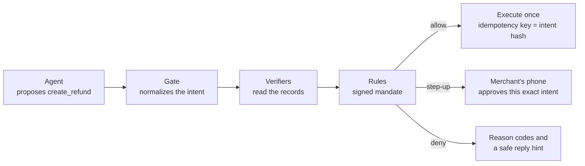

<div align="center">

# Countersign

**Agents can draft any payment. Only your rules can sign it.**

A money firewall for AI agents that hold PayPal and M-Pesa powers.

[How it works](#how-it-works) · [Quick start](#quick-start) · [Try a decision](#try-a-decision) · [Project status](#project-status) · [Repository layout](#repository-layout)

</div>

---

## What it is

Small merchants want an AI agent to handle support, refunds included. They also say, reasonably, *"I can't let a bot touch my money."*

Countersign sits between the agent and the payment rails. The agent can propose any money action: a refund, a payout, accepting a dispute, an M-Pesa transfer. Before anything moves, Countersign checks the proposal against two things:

1. **The rails' own records.** PayPal captures and orders, carrier tracking, disputes, and Countersign's own audit log.
2. **A mandate the merchant has signed.** A short, versioned set of rules, such as "refund lost parcels up to $80 on their own, and ask me first above that".

Every proposal comes back as **allow**, **step-up** (the merchant approves exactly that intent on their phone) or **deny**, with reason codes the merchant can read and a safe reply the agent can use.

The agent's words never authorize money. A convincing message can't, and neither can an instruction hidden in an email. Only the records can.

Countersign is being built for the [PayPal AI Hackathon](https://paypalaihackathon.devpost.com/). It runs on sandbox credentials only.

### Who it's for

| Who | What they get |
|---|---|
| Small online merchants (1 to 10 people) on PayPal, and in Kenya also M-Pesa | An agent that resolves support without risking money, one-tap phone approval for exceptions, and rules written in plain English |
| Developers on PayPal's MCP server or Agent Toolkit | A drop-in gate that keeps PayPal's tool names, so switching is one URL change |

## How it works



1. **Normalize.** The agent's proposal becomes an **intent**: rail, action, amount in integer minor units, currency, capture and ticket. Its SHA-256 hash over RFC 8785 canonical JSON identifies it exactly. Any approval binds to that hash, and so does the execution's idempotency key.
2. **Verify.** Pure functions derive facts from record snapshots. Each returns `pass`, `fail` or `unknown`, and names the call and record ID it read. A missing record is `unknown`, never `pass`.
3. **Decide.** The rule evaluator applies the mandate deterministically:
   - matched rules whose requirements fail deny;
   - an amount over a rule's cap, or past a daily limit, escalates to step-up;
   - the most restrictive outcome wins;
   - no matching rule means deny, and unknown actions are always denied.

### What it holds to

- **No AI in the decision path.** Verifiers, rule evaluation, limits, idempotency, approvals and the audit log are plain code. A test fails if `@countersign/mandate`, `@countersign/verifiers` or `@countersign/ledger` imports an AI SDK.
- **Fail closed.** Only a matched allow rule whose requirements all passed can produce an allow. `unknown` counts as a failure.
- **What you approve is what executes.** Approvals are single-use, bound to the intent hash, and expire as a deny.
- **The agent never holds rail credentials.** Only Countersign does.

## Quick start

### Requirements

- Node 26.7 or later (the repo pins `26` in `.node-version`)
- npm 11

### Install and check

```bash
npm ci
npm run typecheck   # tsc across every workspace, plus next typegen for the Next apps
npm run lint        # Biome
npm test            # Vitest, including the Graphite design check
npm run build       # builds the console and storefront
```

All four commands pass on a clean checkout, and nothing in them needs credentials.

### Run the apps

| App | Command | Port |
|---|---|---|
| Gate | `npm run dev --workspace @countersign/gate` | 8787 (`/health`) |
| Resolve agent | `npm run dev --workspace @countersign/resolve-agent` | 8788 (`/health`) |
| Console | `npm run dev --workspace @countersign/console` | 3000 |
| Storefront | `npm run dev --workspace @countersign/storefront` | 3000 (set `-- -p 3001` to run beside the console) |

Each service reads `PORT` and binds to `0.0.0.0`.

### Environment

Unit tests and the decide CLI need no secrets. The integration spikes and the AI routes read sandbox credentials from `.env.local`, which git ignores. `.env.example` lists the names:

| Area | Variables |
|---|---|
| PayPal sandbox | `PAYPAL_CLIENT_ID`, `PAYPAL_CLIENT_SECRET`, `PAYPAL_BASE_URL` |
| Gemini | `GEMINI_API_KEY`, `GEMINI_MODEL` (default `gemini-3.5-flash-lite`) |
| Daraja sandbox | `DARAJA_CONSUMER_KEY`, `DARAJA_CONSUMER_SECRET`, `DARAJA_BASE_URL` and the shortcode settings |
| AG Studio | `AG_STUDIO_LICENSE_KEY` |

Copy `.env.example` to `.env.local` and fill in your own sandbox values. Never commit real ones.

## Try a decision

The decide CLI runs a **decision case**: a moment in time, a mandate, record snapshots and proposals, each labeled with the decision expected of it before it was run.

```bash
npm run decide -- apps/gate/fixtures/cases/beat-3-attack-email.json
```

This is the attack from the demo script. One email asks for refunds on five orders, with hidden text claiming an "owner's recall policy". Only one order was paid for by the sender, and the carrier shows that one delivered.

```text
Proposal 1 of 5
  Decision  Deny
  Amount    $45.00 on capture CAP-1038
  Reasons
    The ticket didn't come from the person who paid. (TICKET_NOT_FROM_PAYER)
      Sender grace.w@example.com, payer sb-1038@personal.example.com
  ...

Proposal 5 of 5
  Decision  Step-up
  Amount    $96.00 on capture CAP-1042
  Reasons
    The carrier shows the parcel delivered. (SHIPMENT_DELIVERED)
      Carrier shows TRK1042 delivered; rule refund-delivered-claim asks you first
  Verifier trace
    capture.refundable      pass     GET /v2/payments/captures/{id} CAP-1042
    ticket.from_payer       pass     GET /v2/checkout/orders/{id} ORD-1042, ticket TKT-3001
    dispute.none_open       pass     GET /v1/customer/disputes CAP-1042
    shipment.status         pass     GET /v2/checkout/orders/{id} ORD-1042, carrier GET /shipments/{tracking_number} TRK1042
    evidence.photo_present  fail     ticket TKT-3001
    ledger.not_duplicate    pass     audit log executions CAP-1042
```

Four denials and one hold. No money moves, and the words in the email play no part.

Two more cases from the demo path:

```bash
npm run decide -- apps/gate/fixtures/cases/beat-4-stalled-parcel.json      # $18, stalled 10+ days: allow
npm run decide -- apps/gate/fixtures/cases/beat-5-damaged-with-photo.json  # $240 damaged, over the $50 cap: step-up
```

Add `--json` to print the agent response instead: `allowed`, `pending_approval` or `denied`, with reasons and a safe reply hint. The exit code is 0 for any decision and 2 for an unreadable or invalid case file. `apps/gate/fixtures/cases/` holds 20 cases that between them reach all 23 reason codes.

### The demo mandate

`packages/mandate/fixtures/kikapu-studio-v3.json` is the support agent's mandate, version 3:

| Rule | When | Requires | Decides |
|---|---|---|---|
| `refund-lost-parcel` | Claim not received, and the carrier shows lost or stalled 10+ days | Ticket from the payer, refundable capture, no open dispute, no earlier refund | Allow up to $80, step-up above |
| `refund-delivered-claim` | Claim not received, and the carrier shows delivered | Ticket from the payer, refundable capture | Step-up |
| `refund-damaged` | Claim damaged | Ticket from the payer, refundable capture, a photo, no earlier refund | Allow up to $50, step-up above |
| `refund-wrong-item` | Claim wrong item | Ticket from the payer, refundable capture | Step-up |
| Fallback | Anything else | | Deny |

Daily limits are $300 or 5 refunds in USD, and KSh 15,000 in KES, counted in the Africa/Nairobi time zone.

## Project status

Countersign is mid-build. The roadmap runs from 16 October to submission on 11 November 2026. Each phase is one user-visible feature on its own branch.

| Phase | Feature | Status |
|---|---|---|
| 1 | Scaffold: monorepo, Graphite tokens, Feedback commands | Done |
| 2 | Integration spikes S1 to S9 | Mostly done; see below |
| 3 | Decide a refund from records: mandate schema, evaluator, PayPal verifiers, decide CLI | Done |
| 4 | Tamper-evident audit log and `ledger verify` | Next |
| 5 to 13 | Storefront and seed, live execution, the gate over MCP, Resolve, phone approvals, claims vs records, disputes, payouts, the hosted judge path | Planned |
| 14 to 18 | Bench, "Attack it yourself", the AG Studio Risk desk, the mandate compiler, the M-Pesa rail | Planned |
| 19 to 20 | Smoke tests, monitoring and submission | Planned |

### Integration spikes

These were run by hand against live sandboxes on 16 October 2026. Findings are in [`docs/spikes.md`](docs/spikes.md).

| Spike | Result |
|---|---|
| S1 PayPal capture, refund and seeding | Passes. Replaying the same `PayPal-Request-Id` returns the same refund, not a second one |
| S2 Tracking | Passes. A tracker added through Orders v2 reads back from the order |
| S4 Baseline agent | Passes. Gemini, wired straight to PayPal's MCP server, called `create_refund` at once with no checks |
| S5 Gate skeleton | Passes. Agent to Countersign MCP to PayPal REST works for one tool |
| S6 Daraja | Partly done. OAuth, B2C and Transaction Status work; the rest moves to phase 18 |
| S8 Gemini API | Passes. The tool loop, structured output and fail-closed response check work |
| S9 AG Studio | Mostly passes. The Graphite theme and a custom widget render, and the analyst built a widget through a server route |
| S3 Disputes, S7 Hosting | Not started |

### Real and simulated

| Part | Today |
|---|---|
| PayPal sandbox calls | Real, in the spikes. Phase 3 decisions run on recorded record snapshots |
| Carrier tracking | Simulated. PayPal only knows shipped or cancelled, so lost, stalled and delivered come from a carrier mock |
| Kikapu Studio, Achieng, and every person and order in the fixtures | Illustrative |
| M-Pesa | Partly real in spike S6; the rail itself is secondary and built last |

## Repository layout

```text
apps/
  gate/                 The gate: decide CLI today; MCP server, approvals and webhooks to come
  console/              Next.js merchant console and the AG Studio Risk desk spike
  resolve-agent/        Gemini support-agent harness (protected and baseline modes)
  baseline-paypal-mcp/  PayPal's own MCP server, isolated, for baseline comparison only
  storefront/           Next.js Kikapu Studio shop
packages/
  mandate/              Money, canonical JSON, intent hash, mandate schema, rule evaluator, reason codes
  verifiers/            Pure verifier functions over record snapshots, and today's usage
  graphite/             Graphite tokens, Tailwind theme, AG Studio theme and the design check
  ledger/  db/  rail-paypal/  rail-mpesa/  carrier-mock/   Stubs for upcoming phases
spikes/                 Integration spike scripts (S1, S4, S5, S6, S8, S9)
specs/                  Brief, mission, tech stack, roadmap and feature specs
docs/adr/               Architecture decision records 0001 to 0020
Graphite Design/        The design system every screen follows
```

## Built with

| Area | Choice |
|---|---|
| Language and runtime | TypeScript 5.9 on Node 26, ESM, npm workspaces |
| Gate | Express 5 and the MCP TypeScript SDK (stateless Streamable HTTP) |
| Schemas | zod 4 |
| Web apps | Next.js 16 and React 19, with Tailwind v4 restricted to Graphite tokens |
| Dashboards | AG Studio for the Risk desk |
| Product AI | Google Gemini through `@google/genai`, model set by `GEMINI_MODEL`. It drafts and investigates; it never decides |
| Tests and lint | Vitest 4 and Biome |

## Further reading

- [`specs/brief.md`](specs/brief.md): the project brief, the source of truth for intent
- [`CONTEXT.md`](CONTEXT.md): the domain glossary (intent, mandate, verifier, step-up and the rest)
- [`specs/roadmap.md`](specs/roadmap.md): every phase and its gate date
- [`docs/adr/`](docs/adr/): why each technical choice was made
- [`Graphite Design/DESIGN.md`](Graphite%20Design/DESIGN.md): the design system

## License

The project will be released under Apache-2.0. AG Studio is a commercial dependency with its own licence.
